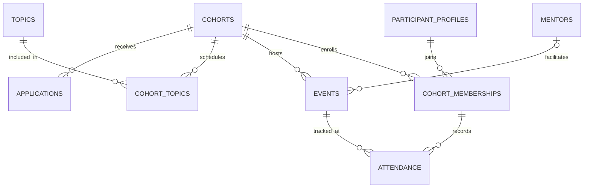
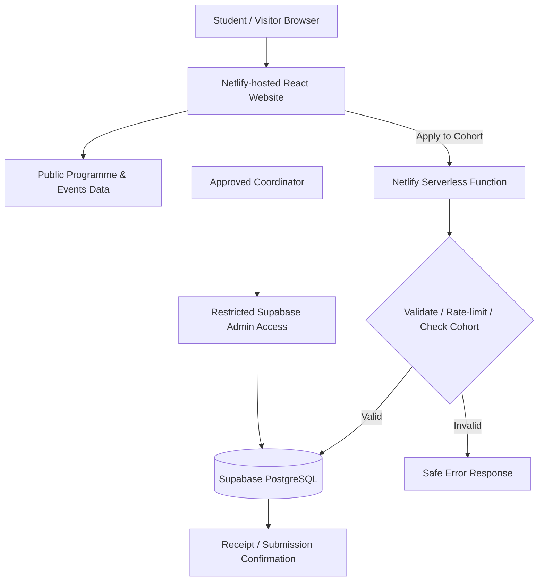

# Men in HR Connect — Requirements and System Design

**Version:** 1.0 (planning baseline)  
**Date:** 27 October 2026  
**Project:** Men in HR Connect  
**Initiative:** Men in HR, JKUAT Human Resource Students' Association (JKUAT HRSA)  
**Status:** Proposed; stakeholder review and implementation pending

> **Project principle:** Start with a useful, lightweight public website, while making deliberate choices that permit expansion into a mentorship management platform. Build only the components needed for the current phase.

---

## 0. Background, goals and boundaries

### Problem statement

Men in HR seeks to increase male HR students' involvement and provide career guidance, mentoring, confidence-building, networking and opportunities for personal and professional growth. Information, student interest and mentor coordination should not depend exclusively on informal chats or manually maintained lists.

### Goals

1. Give students and stakeholders one reliable place to discover the initiative and its programme.
2. Allow students to apply for a cohort with a clear, accessible, mobile-friendly form.
3. Securely store applications and give organisers a controlled way to review them.
4. Publicise approved events and mentors without exposing private meeting or contact details.
5. Preserve a path to later cohorts, mentor participation, member accounts and progress tracking.

### Explicit assumptions — validate before launch

- **Institutional branding:** The right to use JKUAT or JKUAT HRSA logos, endorsement language and official contact channels must be confirmed.
- **Cohort eligibility:** The precise admission policy (including whether only male HR students may participate) is to be approved by the initiative's leadership; do not invent exclusion rules in code.
- **Contacts:** An authorised official email/contact channel will be supplied before the Contact page goes live.
- **Application processing:** At least one trusted coordinator will be responsible for reviewing applications and privacy requests.
- **Mentor consent:** A mentor's name, photo and biography will be published only with permission.
- **Programme schedule:** Sessions/dates are editable content, not hard-coded promises; tentative engagements should be clearly labelled.
- **Retention policy:** Retention periods will be agreed and documented before collecting live applications.

### Stakeholders and roles

| Role | Phase 1 needs | Later phases |
|---|---|---|
| Public visitor | Read about initiative, topics, events, contacts | Browse resources, testimonials with permission |
| Student applicant | Review programme and apply without creating an account | Track application, register for sessions, view progress |
| Mentor | Read programme, agree to publish profile and facilitate sessions | Manage sessions, resources and feedback |
| Organiser/coordinator | Review submissions in a restricted backend | Role-based admin dashboard, cohort management |
| Patron/association leadership | Validate content, governance, programme aims | Review aggregate reports and quality indicators |

---

## 1. Requirements — the first part of the 1 Million Devs framework

### 1.1 Phase 1 functional requirements (MVP)

| ID | Requirement | Acceptance criteria |
|---|---|---|
| FR-01 | A public homepage explains who Men in HR serves and why it exists. | On mobile, a visitor can find the mission and registration CTA without logging in. |
| FR-02 | An About page presents objectives and initiative background accurately. | Copy is approved; no unapproved endorsement or logos. |
| FR-03 | A Programme page shows Cohort 1's eight topics and short descriptions. | Topics appear in the agreed order and can be updated without rewriting components. |
| FR-04 | An Events page lists approved upcoming events in EAT. | Drafts and private meeting URLs never appear in public HTML or API payloads. |
| FR-05 | An application form collects only essential enrolment information. | Required fields are validated client-side and server-side. |
| FR-06 | An application can be submitted only while the target cohort is open. | Closed cohorts reject submission with a clear message. |
| FR-07 | Duplicate applications are handled safely. | The same email cannot create multiple applications to the same cohort. |
| FR-08 | The system confirms receipt without implying acceptance. | Successful submission displays a clear acknowledgement; errors preserve entered values. |
| FR-09 | Submitted personal information stays private. | No anonymous visitor can retrieve applicant lists or details. |
| FR-10 | Visitors can contact organisers through an approved channel. | An official contact method appears; no personal contact details are published unintentionally. |
| FR-11 | Approved mentor profiles can be displayed. | Only records explicitly approved for public display are shown. |
| FR-12 | Privacy information is visible at the application point. | The purpose, data use, contact and relevant rights are clearly described. |

### 1.2 Phased functional requirements

**Phase 2 — Coordination and administration:** authenticated organisers; review/approve/reject applications; edit cohorts, events and mentor profiles; audit administrative changes; export necessary records securely; privacy requests workflow.

**Phase 3 — Participant and mentor portal:** optional student accounts and sign-in; cohort membership; session sign-up and attendance; teaching resources; mentor dashboard; feedback; personal progress.

**Phase 4 — Advanced functionality:** mentor matching, reports and outcome indicators, certificates where appropriate, and notification workflows. Add only if validated by user needs.

### 1.3 Non-functional requirements

| Category | Proposed engineering target |
|---|---|
| Performance | Key pages usable in about 3 seconds on a typical 4G connection; validate with real tests. |
| Asset budget | Aim for no more than roughly 500 KB initial transfer on key public pages before nonessential imagery; optimise images and lazy-load. |
| Responsiveness | Usable from 360 px viewport to desktops without horizontal scrolling. |
| Accessibility | Design and test towards WCAG 2.2 AA: keyboard access, labels, errors, contrast and focus visibility. |
| Security | HTTPS, server-side validation, restrictive permissions, secrets stored server-side, abuse protection. |
| Privacy | Collect the minimum data necessary; privacy notice; no public applicants; defined retention/deletion processes. |
| Availability | Working target of 99.5% monthly availability; not a service-level guarantee. |
| Operability | Readable logs without personal details, backups, restoration test, and clear operational ownership. |
| Maintainability | Modular React components, tests, documented environment variables, meaningful Git commits. |
| Time and locale | Database timestamps in UTC; display in Africa/Nairobi (EAT), with explicit labels. |
| Inclusivity | Plain language, low-bandwidth support, student-tested content; do not assume a restrictive eligibility policy without approval. |

### 1.4 MVP exclusions

The initial version will **not** include student login, mentor matching, live chat, payments, AI recommendations, certificates, public application-status lookup, or private meeting links in public content. This keeps the first release achievable and protects data while the programme is taking shape.

### 1.5 Agreed Cohort 1 programme content

Use this approved working topic list in the initial website, pending final programme review:

1. **Self-Discovery, Personal Growth and Goal Setting** — understanding yourself and setting personal development goals.
2. **Understanding the HR Profession and Career Pathways** — HR career paths, professional expectations, certifications, professional examinations and continuing professional development.
3. **Personal Branding, CV Writing and Employability** — professional identity and preparing for opportunities.
4. **Communication, Confidence and Public Speaking** — confident, effective professional communication.
5. **Mentorship, Networking and Professional Relationships** — building professional connections and learning from practitioners.
6. **Leadership, Professional Ethics and Workplace Readiness** — integrity, teamwork, leadership and workplace skills.
7. **Financial Literacy, Resilience and Managing Life's Pressures** — financial habits and life pressures.
8. **Personal Development Review, Career Action Planning and the Future** — reviewing growth and setting next steps.

### 1.6 Initial sitemap

```text
/
├── About
├── Programme
│   └── Cohort 1: Eight topics
├── Events
├── Get Involved
│   └── Apply to Cohort
├── Mentors (only after publication approval)
├── Contact
└── Privacy Notice
```

### 1.7 Proposed registration data

Required: full name, email address, cohort selection, and a confirmation that the applicant has been shown the privacy notice. Optional pending approval: institution, year of study, preferred mentorship topics, brief motivation and telephone/WhatsApp number. Do not ask for ID numbers, home addresses, date of birth, ethnicity, medical information or other unnecessary personal data. If optional updates/marketing are added, ask separately and do not bundle them with the application.

---

## 2. Realistic estimates — the second part of the framework

These are **planning assumptions**, not observed Men in HR usage figures.

| Parameter | Initial assumption | Reason |
|---|---:|---|
| Monthly public visitors | 300–1,000 | Student initiative with social/association referrals |
| Applications per cohort | 50–200 | Initial cohort recruitment scale |
| Cohorts each year | 2 | Illustrative operational cadence, subject to leadership |
| Sessions per cohort | ~8 | Matches eight proposed topics, though exact event count may differ |
| Public mentors | 5–20 | Planning range for profiles |
| Busy-period concurrent visitors | 20–50 | Registration/social-media announcement spike |
| Peak API requests | Design for ~5 requests/second | Generous early engineering headroom, not measured demand |

**Data volume example:** 200 applications × 2 cohorts = 400 applications/year; 5 years would yield around 2,000 application records before retention/deletion. This is small for PostgreSQL. The dominant near-term risks are unauthorised data exposure, spam submissions and operational complexity, not database scale.

**Transfer example:** 1,000 visits/month × 0.5 MB of page assets ≈ 500 MB/month before caching and additional navigation. Keeping pages lightweight matters more to students than premature autoscaling.

---

## 3. API design — the third part of the framework

The URLs below describe the **contract we may implement**, not currently deployed endpoints. Phase 1 can keep approved informational content in version-controlled data files while the private submission endpoint is connected to the database; do not build unused read APIs prematurely.

| Method | Route | Purpose | Access / notes |
|---|---|---|---|
| GET | `/api/cohorts` | List published cohorts | Public; no private fields |
| GET | `/api/cohorts/:slug` | View one published cohort | Public |
| GET | `/api/cohorts/:slug/topics` | View ordered programme topics | Public |
| GET | `/api/events?upcoming=true` | Show published events | Public; omit private meeting URLs |
| GET | `/api/mentors` | Show approved mentor profiles | Public; do not expose personal email |
| POST | `/api/applications` | Submit a cohort application | Public with validation, rate limiting and spam protection |
| GET | `/api/admin/applications` | Review applications | Phase 2; authenticated authorised admin only |
| PATCH | `/api/admin/applications/:id` | Change application status | Phase 2; authorised admin only; audit changes |
| POST | `/api/admin/events` | Create/publish events | Phase 2; authenticated authorised admin only |

**Example Phase 1 application request** (illustrative, not a live API):

```json
{
  "cohort_slug": "cohort-1",
  "full_name": "Example Applicant",
  "email": "example@example.org",
  "institution": "JKUAT",
  "year_of_study": "2",
  "topic_interests": ["communication", "career-pathways"],
  "privacy_notice_acknowledged": true
}
```

**Success:** `201 Created` with a non-sensitive receipt identifier and `status: "received"`; this does **not** imply acceptance.  
**Invalid data:** `400 Bad Request`.  
**Cohort closed:** `409 Conflict`.  
**Existing email + cohort:** `409 Conflict` with an account-enumeration-aware response policy.  
**Rate limited:** `429 Too Many Requests`.  
Do not include confidential participant records in responses, logs or analytics.

---

## 4. Relational data model — the fourth part of the framework

### Core tables for Phase 1

| Table | Key fields | Notes |
|---|---|---|
| `cohorts` | `id` PK, `slug` UNIQUE, `name`, `status`, `opens_at`, `closes_at` | Cohort status: draft, open, closed, active, completed |
| `topics` | `id` PK, `slug` UNIQUE, `title`, `summary` | Reusable across cohorts |
| `cohort_topics` | `cohort_id` FK, `topic_id` FK, `sequence_no` | Join table defining cohort topic order; UNIQUE (cohort_id, sequence_no) |
| `events` | `id` PK, `cohort_id` FK nullable, `title`, `starts_at`, `ends_at`, `status`, `join_url_private` nullable | Only selected public columns may be exposed |
| `applications` | `id` PK, `cohort_id` FK, `full_name`, `email`, optional fields, `status`, `privacy_notice_version`, `created_at` | Private, with per-cohort email uniqueness |
| `mentors` | `id` PK, `display_name`, `headline`, `bio`, `photo_url`, `publish_approved` | Only consent-approved profiles returned to visitors |

### Planned later-phase tables

| Table | Role |
|---|---|
| `staff_profiles` | Admin/coordinator account mapped to managed authentication |
| `participant_profiles` | Signed-in participants, if student logins become necessary |
| `cohort_memberships` | Connect accepted participants to one or more cohorts |
| `attendance` | Associate a cohort participant with an event and attendance status |
| `resources` | Learning materials associated with cohorts/topics/events |
| `feedback` | Session feedback, protected from unintended public disclosure |
| `audit_log` | Track significant administration actions |

### Key relationships



Phase 1 avoids the need to create participant accounts just to apply. Later, an accepted applicant may be invited to create a profile and be associated with a membership, using an explicitly verified email process rather than assuming any self-declared email proves ownership.

### Database integrity and privacy

- Use UUID primary keys and proper foreign keys.
- Add a case-insensitive uniqueness constraint/index on `(cohort_id, lower(email))` in `applications` after normalising email input; handle conflicts gracefully.
- Restrict all application reads to trusted back-end processes and authorised staff.
- When using Supabase, enable Row Level Security and review PostgreSQL grants on every exposed table. Avoid exposing service-role/secret credentials to browsers.
- Expose event public fields through explicit projections so private meeting links cannot leak accidentally.
- Use schema migrations to track structural changes in Git.

---

## 5. High-level architecture — the fifth part of the framework

### Proposed technology choices

| Layer | Choice | Rationale |
|---|---|---|
| Frontend | React + Vite + TypeScript | Reusable pages, growing app, static deployment, explicit data types |
| Styling | Plain CSS / CSS Modules initially | Learnable, maintainable; avoid extra tooling without a need |
| Hosting | Netlify | Static website and serverless endpoint support |
| Submission API | Netlify Function / server-side handler | Keeps privileged data access away from client code |
| Database | Supabase PostgreSQL | Relational model supports later accounts, sessions and memberships |
| Authentication | None for Phase 1 applicants; Supabase Auth for admin later | Avoid unnecessary student accounts, then secure admin roles |
| Source control | Git + GitHub | Reviewable incremental changes and backup of source code |
| Testing | Vitest + React Testing Library; Playwright later | Unit/form tests first; critical end-to-end tests as app grows |

### Request flow



**Public pages:** Visitors read content hosted on the static site.  
**Application flow:** Browser sends validated data to a server-side endpoint, which checks inputs and writes to private database tables.  
**Phase 1 admin:** A small number of authorised coordinators review submissions using a restricted back-office interface; the public website exposes no administrative controls.  
**Phase 2 admin:** Replace manual database review with a role-protected dashboard.  
**Privacy:** Never send application lists, private meeting links, database secrets or full personal records to public browser code.

### Proposed repository structure

```text
men-in-hr-connect/
├── README.md
├── .gitignore
├── .env.example                 # variable names only, NO secrets
├── docs/
│   ├── requirements-and-system-design.md
│   ├── decisions.md
│   └── testing-checklist.md
├── public/
│   └── images/
├── src/
│   ├── components/              # Header, Footer, TopicCard, EventCard
│   ├── pages/                   # Home, About, Programme, Events, Apply...
│   ├── data/                    # Approved public information initially
│   ├── hooks/
│   ├── styles/
│   ├── lib/                     # Validation, API client, formatting
│   ├── App.tsx
│   └── main.tsx
├── netlify/
│   └── functions/              # Secure submission handler
├── supabase/
│   └── migrations/
└── tests/
```

---

## 6. Bottlenecks, risks and trade-offs — the sixth part of the framework

| Decision or risk | Benefit / concern | Response |
|---|---|---|
| Static public site first | Fast, cheap and reliable; content updates may initially require a redeploy | Keep editable content separate; build admin content management only when necessary |
| Supabase from first real application | Slight extra setup, avoids migrating scattered registration spreadsheets later | Use minimal schema and a simple server-side endpoint |
| No student accounts for registration | Fewer steps, good for mobile | No self-service status tracker in Phase 1; send clear receipts, add accounts only when useful |
| Password-protected admin dashboard later | More development effort, better delegation | Start with 1–2 trusted coordinators and restricted back-office access |
| Spam or automated submissions | Can pollute data and trigger costs | Honeypot, validated input, rate limits, monitoring; add stronger challenge only if needed |
| Registration data leakage | Major privacy/trust risk | Private data model, access controls, no public GET endpoints, permission tests |
| Unapproved portraits, logos or endorsements | Can harm dignity, trust or institutional relationships | Publish only with approval; prefer non-identifying illustrations otherwise |
| Unexpected event or meeting changes | Students may follow stale links | Keep programme statuses, event timestamps and owner-reviewed content |
| Overengineering | Takes time away from launching a usable programme | Defer dashboards, AI, messaging and sophisticated mentor matching |

### Privacy and legal review

Kenyan applicant information raises responsibilities under the **Data Protection Act, 2019** and applicable regulations. Before launching a live registration form, agree who is responsible for the data, the lawful basis and notice, access permissions, retention/deletion process and how people can request correction or deletion. Consult the Office of the Data Protection Commissioner guidance and institutional requirements as appropriate. Do not assume that merely displaying a consent checkbox makes every data-handling practice compliant.

Relevant primary sources:
- [ODPC — Kenyan data protection laws](https://www.odpc.go.ke/data-protection-laws-kenya/)
- [ODPC — Data subject rights](https://www.odpc.go.ke/rights-of-a-data-subject/)
- [Supabase — Row Level Security](https://supabase.com/docs/guides/database/postgres/row-level-security)
- [Netlify — Spam filters](https://docs.netlify.com/manage/forms/spam-filters/)

---

## 7. User journey and page behaviour

**Public visitor:** Open homepage → understand mission → see cohort topics or next event → view contact details.  
**Prospective participant:** Open Programme → click Apply → review privacy information → submit short form → receive accurate receipt or actionable validation error.  
**Organiser (Phase 1):** Check submissions in protected backend → decide on applications outside the public website → communicate using approved channels.  
**Organiser (Phase 2):** Sign in → review cohort applications → update statuses → manage events and approved mentors.  
**Mentor (later):** Receive invitation → manage own profile and materials → facilitate assigned sessions.

### Recommended homepage layout

1. **Hero:** Men in HR identity, concise purpose and a single primary "Explore the Programme" / "Apply" action based on whether registration is open.
2. **Why Men in HR:** Brief reason for the initiative and expected student benefits.
3. **Our Focus Areas:** Four concise pillars such as mentorship, career readiness, networking and growth.
4. **Cohort 1:** A preview of all eight agreed topics.
5. **Events:** Upcoming approved engagements with visibly labelled EAT times.
6. **Get Involved:** Student pathway and mentor interest/contact pathway.
7. **Footer:** Organisation identification, approved contact details and privacy link.

Avoid fake testimonials, fake programme impact statistics, fabricated mentors or claims that sessions have already happened.

---

## 8. Delivery roadmap with release gates

| Milestone | Implementation | Completion gate |
|---|---|---|
| M0 — Design | Confirm scope, content and approvals; record decisions | Patron/organiser review of copy, basic eligibility and data-handling policy |
| M1 — Public interface | React project; responsive Home, About, Programme, Events, Contact, Privacy | Pages work on mobile and keyboard; correct eight topics; no fabricated claims |
| M2 — Application service | Minimal SQL schema, protected server-side submission, form validation | Normal/invalid/duplicate/closed cohort requests tested; database access restricted |
| M3 — MVP launch | Deployment, accessibility, performance, security checks, monitoring | Real end-to-end application tested; privacy and contact ownership agreed |
| M4 — Admin expansion | Protected admin accounts; application/event/cohort tools | Role access and audit tests pass; admins can manage without SQL |
| M5 — Member portal | Participants, resources, attendance and feedback | User-tested; only validated features implemented |

### Testing gates

- Content: eight approved Cohort 1 topics remain in the proper order; events clearly identify EAT.
- Accessibility: keyboard navigation, accessible names, form errors and contrast are checked.
- Responsiveness: no overlap at 360 px width; forms work on low-cost phones.
- Form logic: bad email, empty name, closed cohort, network failure, duplicates and success all handled.
- Security: anonymous users cannot query applicant data; no secret in repository/client build; unapproved mentor profile invisible.
- Privacy: the form collects no unnecessary sensitive information; users see a clear notice and data contact.
- Maintenance: README instructions reproduce local setup; clean builds; tests run; meaningful commits.

### Git workflow (small, reviewed steps)

Proposed commits:

```text
chore: initialize Men in HR Connect app
 docs: add requirements and system design
feat: build accessible navigation and landing page
feat: add cohort programme and events pages
feat: add validated cohort application form
feat: persist applications via secure API
 test: cover submission and access-control cases
 docs: document setup and launch checks
```

Each feature should be committed before moving to the next, with a working build after each milestone. Push to GitHub only after confirming the target repository and authentication; **no push has been performed as part of this design document**.

---

## 9. AI Safari principles applied

| Principle | Practical implementation |
|---|---|
| Decomposition | Break website, application service, administration and mentor/student portals into manageable phases |
| User-centred design | Validate application language and navigation with actual students and organisers |
| Constraint-aware / offline-aware | Design primarily for mobile, low-bandwidth contexts; provide lightweight fallback states |
| ETHOS / OASIS privacy mindset | Explain collection purposes, minimise data, obtain permission for public profiles, enable withdrawal/request workflows |
| TRACK ethical review | Check who is represented, potential unintended exclusion, misleading claims and misuse or amplification of private data |
| OCEAN verification | Verify dates, mentor participation, programme status and claims instead of generating plausible content |
| Human-in-the-loop | Programme coordinators decide applications and mentor approvals; automated systems only assist |
| Iterative testing | Test each function against requirements before introducing the next layer |

AI will be used to assist development and accessibility/content reviews, **not** to make automatic, opaque decisions on student eligibility or worthiness.

---

## 10. Decisions to settle before collecting real data

| Decision | Current proposed default | Approver |
|---|---|---|
| Name | Men in HR Connect (working name) | Initiative leadership |
| Eligibility | Publish a leadership-approved policy; do not assume | Patron/leadership |
| Official branding | Use approved Men in HR identity; confirm JKUAT marks | JKUAT HRSA/authorised owner |
| Public contact | An official programme email/contact channel | Coordinator |
| Mandatory application fields | Name, email and cohort; others optional | Programme organisers |
| Applications reviewer | A small, authorised coordinator team | Programme leadership |
| Data retention and rights contact | Written policy before launch | Responsible organiser/institution |
| First published event | Show only approved and confirmed details | Event organiser |

## Immediate next implementation step

Create a new Git repository/project, add this document under `docs/`, and establish the minimal React + Vite + TypeScript application with a clean, mobile-first homepage shell. **Do not implement accounts or advanced admin features yet.** Confirm brand copy, programme eligibility and data-handling ownership before publishing or collecting live information.
